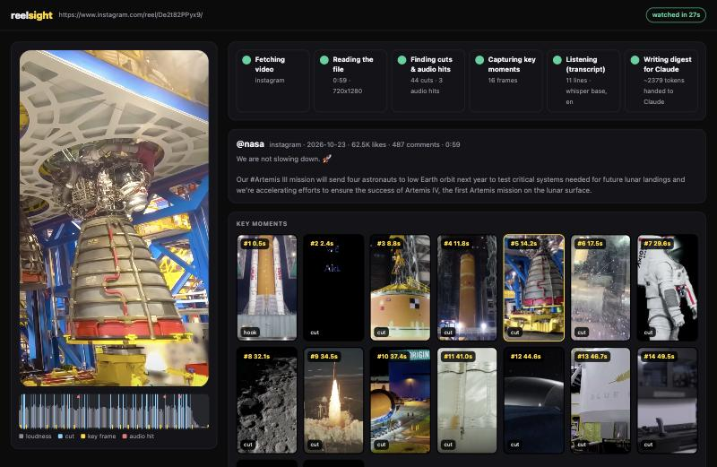
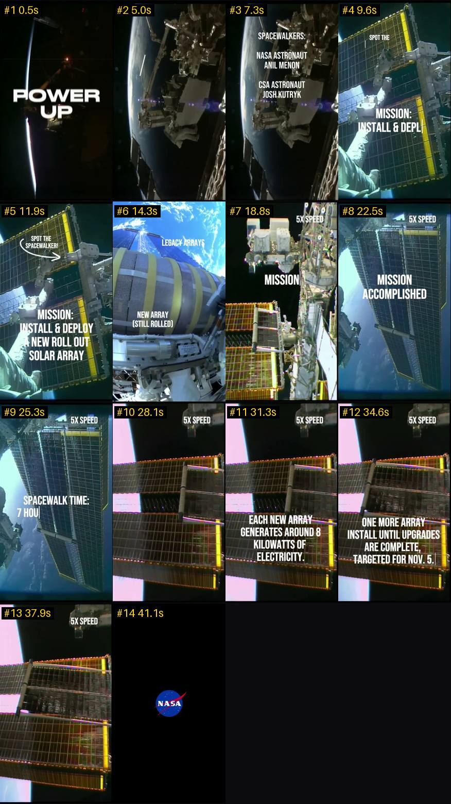

<div align="center">

# ReelSight

**Give Claude eyes and ears for short-form video.**

Send Claude an Instagram Reel, TikTok or YouTube Short. It watches it: hears every word, sees every key moment, and understands the whole thing in about **2.5k tokens**.



</div>

---

## Why it's different

Most "video understanding" hacks either dump a frame every second (30k+ tokens for a one-minute reel) or only read the caption. ReelSight watches the way an editor does:

- **🎬 Finds the moments that matter.** It detects scene cuts and sudden audio hits (beat drops, punchlines, bangs), and always captures the hook and the ending. Frames land just *after* a cut, once animated captions have settled. Near-duplicate frames are dropped.
- **🧩 One image, not twenty.** Key frames are packed into a single labeled contact sheet (`#n time`) that Claude reads once. On-screen text stays legible.
- **👂 Hears it.** It uses platform captions when they exist and local Whisper when they don't. The speech is threaded into a timeline under the frame it belongs to, so Claude knows *what was said while what was on screen*.
- **📺 Lets you watch along.** A live viewer pops up in its own window: the player, a loudness timeline with cut and hit markers, frames appearing as they're captured, a transcript streaming in, and a final "Handed to Claude ✓" handoff. Click any frame or line to jump there.
- **💬 Claude keeps the conversation.** The digest goes straight back into your chat, so you can ask follow-ups ("write me 3 hooks in this style", "fact-check 0:14", "turn it into a recipe card").
- **🔒 Local and cached.** Everything runs on your machine. Re-asking about the same link is instant and free.

### What Claude actually receives

```text
# REELSIGHT · instagram · @nasa · 0:59 · 720x1280 · 30fps
URL: https://www.instagram.com/reel/De2t82PPyx9/
posted 2026-10-23 · 62.5K likes · 487 comments
Caption: We are not slowing down. 🚀 Our #Artemis III mission will send four astronauts …
Audio: speech (whisper base, en, 177 words, 92% of runtime)
Editing: 44 cuts, avg shot 1.3s · audio hits at 18.8s, 46.0s, 50.8s

## Timeline  (#frame time [why] — speech until next frame)
#1 0.5s [hook] — "The standard that we should continuously aspire to exceed, …"
#2 2.4s [cut] — "that engineering ownership back to NASA because great nations …"
…
SHEET: ~/.cache/reelsight/instagram-c0bb676290/sheet.jpg
```

…plus this single image (~1.8k tokens):



## Install

**Requirements:** macOS or Linux, [`ffmpeg`](https://ffmpeg.org), and [`uv`](https://docs.astral.sh/uv/). uv fetches yt-dlp, faster-whisper and Pillow on first run, so there's nothing to pip install.

### Option A: Claude Code plugin

```text
/plugin marketplace add gaviruatt/reelsight
/plugin install reelsight@reelsight
```

### Option B: clone and link

```bash
git clone https://github.com/gaviruatt/reelsight.git && ./reelsight/install.sh
```

`install.sh` installs ffmpeg and uv if they're missing (via Homebrew where available), links the skill into `~/.claude/skills/reelsight`, and warms up the dependencies.

## Use

Just talk to Claude:

> watch this https://www.instagram.com/reel/…
>
> what's the hook in this TikTok and why does it work? https://www.tiktok.com/@…/video/…
>
> /reelsight:watch ~/Downloads/clip.mp4 summarise the steps

Works with anything [yt-dlp](https://github.com/yt-dlp/yt-dlp/blob/master/supportedsites.md) can fetch: Instagram, TikTok, YouTube Shorts, X/Twitter, Facebook, Reddit, Snapchat Spotlight, Twitch clips, Vimeo and more, plus local files.

### Options

| Flag | What it does |
|---|---|
| `--cookies chrome` | Use your browser's login for private or login-walled posts (Claude asks first) |
| `--model small` | More accurate transcription (default `base`) |
| `--lang en` | Force the transcription language |
| `--frames N` | Frame budget (auto 6–16 by length) |
| `--at 12.4,15` | Grab full-resolution frames at exact seconds from a cached video |
| `--no-view` | Skip the browser window (`REELSIGHT_NO_VIEW=1` also works) |
| `--fresh` | Ignore the cache |

Environment variables: `REELSIGHT_HOME` (cache folder, default `~/.cache/reelsight`), `REELSIGHT_MODEL`, and `REELSIGHT_BROWSER=default` (use your default browser instead of a separate app window).

## How it works

```text
URL ─► yt-dlp ─► ffprobe ─► scene-cut scan + loudness scan ─► pick key moments
                                                                  │
         digest.md ◄── timeline (frames × speech) ◄── Whisper / captions
             │                     ▲
             │               contact sheet (1 image)
             ▼
     Claude (chat)        live viewer (localhost, own window)
```

| Piece | File |
|---|---|
| Skill instructions (kept short so it costs few tokens) | [`skills/reelsight/SKILL.md`](skills/reelsight/SKILL.md) |
| Pipeline | [`skills/reelsight/scripts/watch.py`](skills/reelsight/scripts/watch.py) |
| Live viewer (localhost only, exits after 30 idle minutes) | [`viewer.py`](skills/reelsight/scripts/viewer.py) · [`viewer.html`](skills/reelsight/scripts/viewer.html) |

## Privacy

Videos, frames and transcripts stay in `~/.cache/reelsight` on your machine. The viewer binds to `127.0.0.1` only. Browser cookies are used only when you pass `--cookies`, and yt-dlp reads them locally. Respect creators' rights and the platforms' terms when you download content.

## License

MIT © Gaviru Attanayake. Built with [Claude Code](https://claude.com/claude-code).
